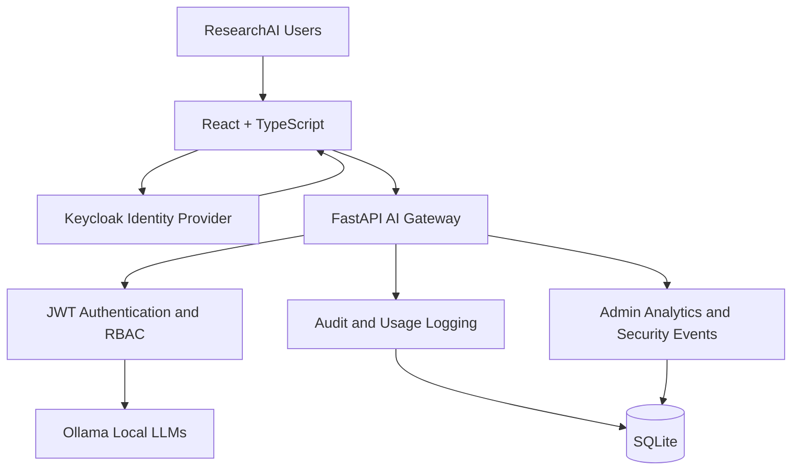
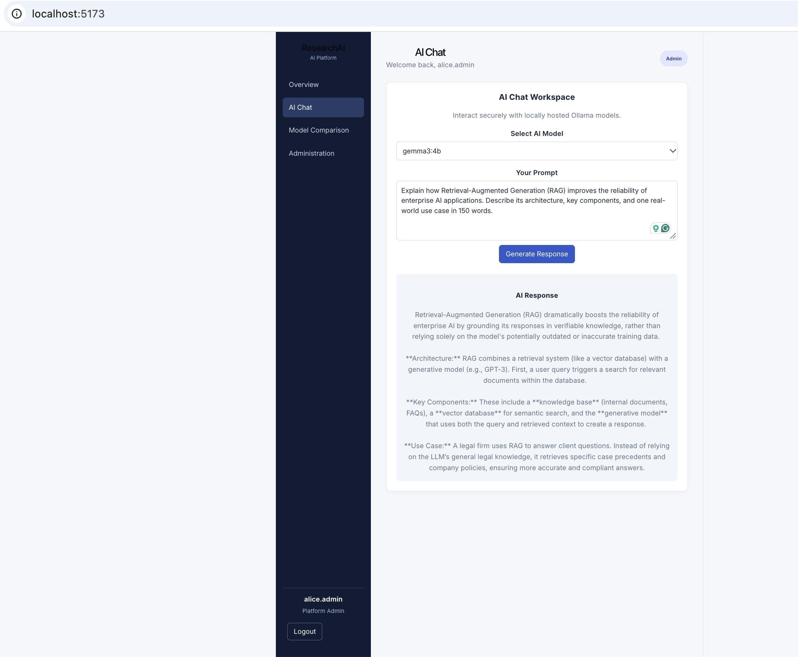
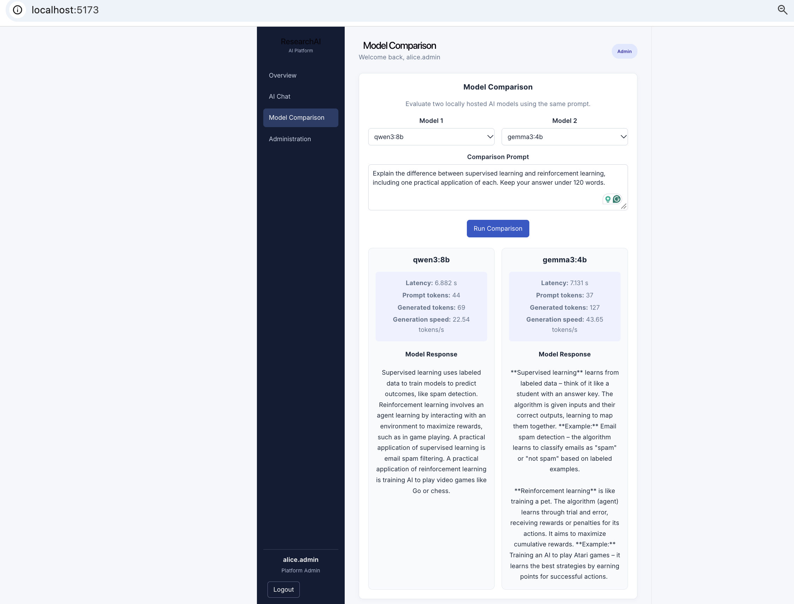
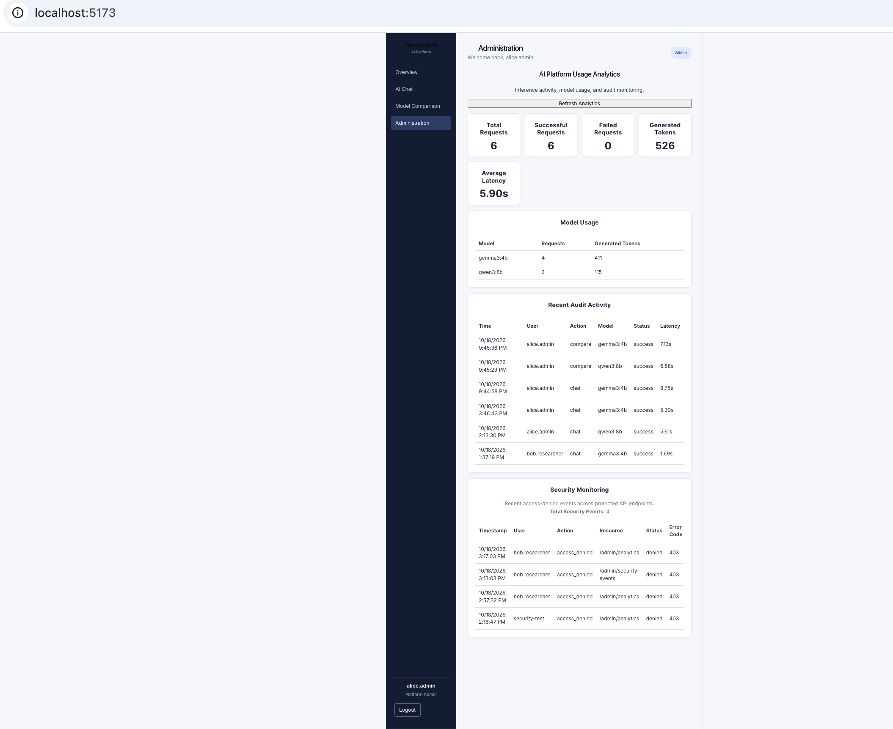
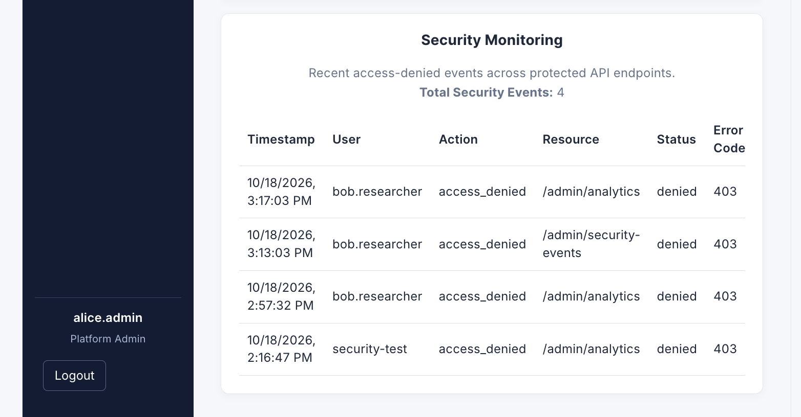
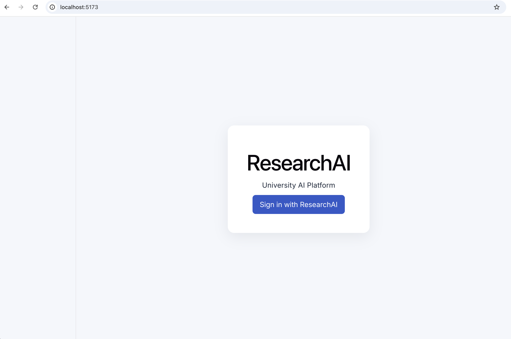

# ResearchAI — Enterprise AI Platform

**A secure, role-based AI platform for research environments, featuring local LLM inference, model comparison, usage analytics, and security auditing.**

ResearchAI is a full-stack AI platform designed to demonstrate how organizations can provide controlled access to large language models through a centralized AI gateway.

The platform combines a React frontend, FastAPI backend, Keycloak identity management, and Ollama-powered local inference.

## Key Features

- **AI Chat:** Interact with locally hosted language models through Ollama.
- **Multi-Model Comparison:** Compare responses, inference latency, token usage, and generation throughput across multiple models.
- **Authentication:** OpenID Connect authentication through Keycloak.
- **Role-Based Access Control:** Student, Faculty, and platform-admin permissions.
- **AI Gateway:** Centralized FastAPI endpoints for model discovery, inference, and comparison.
- **Usage Analytics:** Administrator access to aggregated AI usage metrics.
- **Security Auditing:** Records AI request outcomes and exposes administrator-only security event reports.
- **Containerized Deployment:** Docker Compose for the backend and Keycloak services.
- **Automated Testing:** Pytest and GitHub Actions for backend validation.

## Technology Stack

| Layer | Technologies |
|---|---|
| Frontend | React, TypeScript, Vite |
| Backend | Python, FastAPI, Pydantic, HTTPX |
| AI Inference | Ollama, Local LLMs |
| Identity Management | Keycloak, OpenID Connect, JWT |
| Authorization | Role-Based Access Control |
| Database | SQLite |
| Infrastructure | Docker, Docker Compose |
| CI/CD | GitHub Actions, Pytest |

## System Architecture



## User Roles

| Role | Permissions |
|---|---|
| Student | AI chat, model discovery, student dashboard |
| Faculty | Student features, model comparison, faculty dashboard |
| platform-admin | All application features, administrative dashboards, analytics, and security events |

## API Endpoints

| Method | Endpoint | Access |
|---|---|---|
| GET | `/health` | Public |
| GET | `/models` | Student, Faculty, Admin |
| POST | `/chat` | Student, Faculty, Admin |
| POST | `/compare` | Faculty, Admin |
| GET | `/auth/me` | Authenticated users |
| GET | `/student/dashboard` | Student, Faculty, Admin |
| GET | `/faculty/dashboard` | Faculty, Admin |
| GET | `/admin/dashboard` | Admin |
| GET | `/admin/analytics` | Admin |
| GET | `/admin/security-events` | Admin |

## Development Status

ResearchAI is a completed local-development MVP and portfolio demonstration. Production deployment would require additional security hardening, operational configuration, and validation.

## Getting Started

### Prerequisites

- Python 3.11+
- Node.js and npm
- Docker Desktop with Docker Compose
- Ollama
- Git

### 1. Clone the repository

```bash
git clone https://github.com/pratikshac15/enterprise-ai-platform.git
cd enterprise-ai-platform
```

### 2. Configure environment variables

Create a local environment file from the provided template:

```bash
cp infrastructure/.env.example infrastructure/.env
```

Edit `infrastructure/.env` and replace the placeholder with a strong, unique Keycloak bootstrap administrator password.

**Security:** Never commit `infrastructure/.env`, access tokens, or actual passwords. The bootstrap password is used when initializing Keycloak and does not reset an existing administrator password.

### 3. Start Ollama

Install and start Ollama, then download a model:

```bash
ollama pull qwen3:8b
```

Ensure the Ollama service is running on port `11434`.

### 4. Start the backend and Keycloak

```bash
docker compose --env-file infrastructure/.env \
  -f infrastructure/compose.yaml up -d --build
```

Services:

| Service | Local URL |
|---|---|
| FastAPI Backend | http://localhost:8000 |
| FastAPI Documentation | http://localhost:8000/docs |
| Keycloak Admin Console | http://localhost:8080/admin/ |

On a fresh Keycloak database, sign in to the `master` realm using the bootstrap administrator credentials. Configure the `researchai` realm, OIDC client, roles, and application users before using the frontend.

### 5. Start the React frontend

```bash
cd frontend
npm ci
npm run dev
```

Open http://localhost:5173.

### 6. Run backend tests

From the repository root, create and activate a Python virtual environment if needed:

```bash
python3 -m venv .venv
source .venv/bin/activate
pip install -r backend/requirements.txt
pip install pytest
```

Run:

```bash
python -m pytest backend/tests -v
```

The repository also includes a GitHub Actions workflow at `.github/workflows/backend-tests.yml` for automated backend testing.

## Security and Access Control

ResearchAI uses Keycloak for authentication and FastAPI dependencies for server-side authorization.

- JWT-based API authentication
- Role-based endpoint permissions
- Administrator-only analytics and security-event endpoints
- Audit records for AI inference and model comparison
- Environment-based configuration for sensitive bootstrap credentials
- Localhost-bound backend and Keycloak ports for development

The included Docker Compose configuration uses Keycloak development mode. Additional hardening is required before deploying the platform to a publicly accessible production environment.

## Screenshots

Screenshots of the following interfaces can be added under `docs/screenshots/`:

### AI Chat


### Model Comparison


### Admin Dashboard


### Security Events


### Login


## Future Improvements

- Automated Keycloak realm provisioning
- Additional authenticated RBAC integration tests
- Production-grade identity and database configuration
- HTTPS and deployment automation
- Expanded AI observability and monitoring

## Project Purpose

ResearchAI demonstrates the integration of full-stack software engineering, local generative AI, identity and access management, API security, observability, and containerized infrastructure into a unified enterprise-style AI platform.

